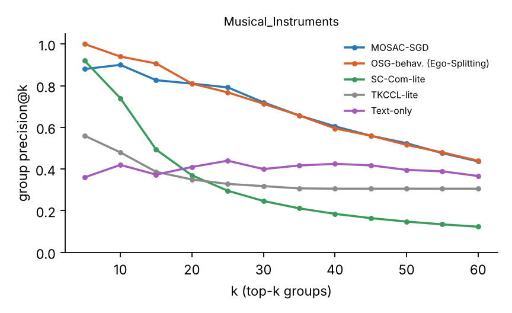
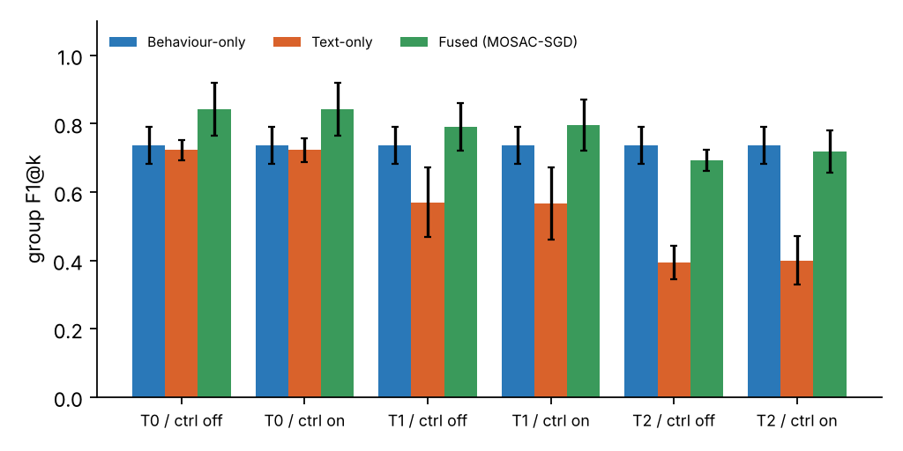
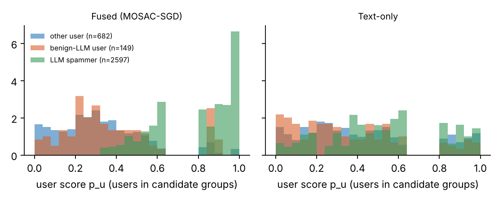
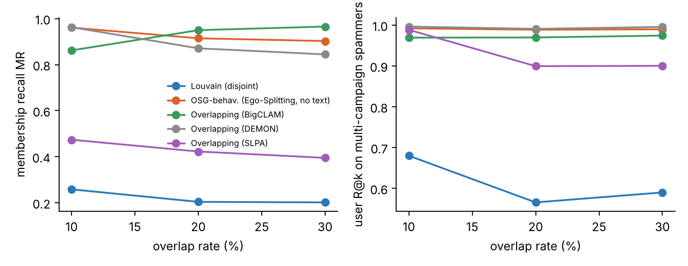
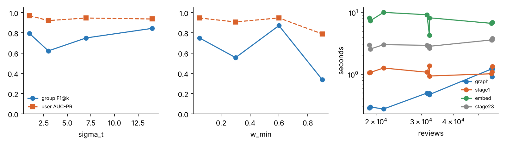

# MOSAC-SGD: measured results

All numbers below were produced by `python -m src.run` (see README). Mean ± std over seeds; group metrics use Jaccard ≥ 0.5; user-level k = number of injected spammer accounts.

## Dataset and graph statistics (test injections)

| host | users | items | reviews | graph_edges | campaigns | spammers | multi | campaign_reviews | camouflage_reviews | benign_llm_reviews |
|---|---|---|---|---|---|---|---|---|---|---|
| Musical_Instruments | 11569 ± 49 | 1897 ± 0 | 56546 ± 851 | 9793 ± 1752 | 30 ± 0 | 536 ± 49 | 134 ± 12 | 3387 ± 359 | 5362 ± 498 | 1693 ± 179 |
| All_Beauty | 6774 ± 49 | 1859 ± 0 | 26608 ± 840 | 9797 ± 1777 | 30 ± 0 | 536 ± 49 | 134 ± 12 | 3388 ± 361 | 5294 ± 482 | 1694 ± 180 |

Validation-selected settings (All_Beauty): `{'host': 'All_Beauty', 'best_w': {'Louvain': 0.6, 'EgoSplit': 0.05, 'BigCLAM': 0.05, 'DEMON': 0.05, 'SLPA': 0.05}, 'algo': 'DEMON', 'scorer': 'directional', 'tau_g': 0.0}`

Validation-selected settings (Musical_Instruments): `{'host': 'Musical_Instruments', 'best_w': {'Louvain': 0.05, 'EgoSplit': 0.05, 'BigCLAM': 0.05, 'DEMON': 0.05, 'SLPA': 0.05}, 'algo': 'DEMON', 'scorer': 'directional', 'tau_g': 0.8}`

## Stage 1: group discovery (RQ2)

| host / algo | ONMI | gRecAll | MR | MMR | n_groups | t_stage1 |
|---|---|---|---|---|---|---|
| Musical_Instruments / Louvain | 0.148 ± 0.019 | 0.247 ± 0.030 | 0.221 ± 0.019 | 0.000 ± 0.000 | 85.800 ± 1.924 | 0.081 ± 0.010 |
| Musical_Instruments / EgoSplit | 0.625 ± 0.054 | 0.907 ± 0.076 | 0.902 ± 0.070 | 0.908 ± 0.078 | 70.800 ± 3.033 | 1.384 ± 0.352 |
| Musical_Instruments / BigCLAM | 0.740 ± 0.019 | 0.960 ± 0.028 | 0.964 ± 0.015 | 0.965 ± 0.012 | 84.000 ± 5.657 | 7.535 ± 1.332 |
| Musical_Instruments / DEMON | 0.588 ± 0.063 | 0.880 ± 0.110 | 0.880 ± 0.115 | 0.883 ± 0.108 | 77.800 ± 4.087 | 1.153 ± 0.287 |
| Musical_Instruments / SLPA | 0.343 ± 0.018 | 0.713 ± 0.051 | 0.421 ± 0.039 | 0.138 ± 0.039 | 136.600 ± 5.128 | 0.507 ± 0.117 |
| All_Beauty / Louvain | 0.307 ± 0.053 | 0.320 ± 0.080 | 0.260 ± 0.040 | 0.000 ± 0.000 | 21.200 ± 2.864 | 0.051 ± 0.010 |
| All_Beauty / EgoSplit | 0.653 ± 0.053 | 0.907 ± 0.076 | 0.902 ± 0.069 | 0.908 ± 0.077 | 61.800 ± 2.280 | 1.551 ± 0.387 |
| All_Beauty / BigCLAM | 0.771 ± 0.022 | 0.973 ± 0.028 | 0.971 ± 0.016 | 0.973 ± 0.021 | 75.800 ± 3.114 | 7.835 ± 1.469 |
| All_Beauty / DEMON | 0.610 ± 0.062 | 0.860 ± 0.109 | 0.853 ± 0.108 | 0.843 ± 0.104 | 64.800 ± 3.114 | 1.188 ± 0.339 |
| All_Beauty / SLPA | 0.375 ± 0.025 | 0.687 ± 0.069 | 0.417 ± 0.032 | 0.140 ± 0.025 | 87.800 ± 4.147 | 0.526 ± 0.083 |

## E1: main comparison (T2 LLM-diverse text, benign-LLM control on, overlap 25%)

| host / method | gP | gF1 | uP | uAP | MR |
|---|---|---|---|---|---|
| Musical_Instruments / Behavioural IF | -- | -- | 0.506 ± 0.046 | 0.447 ± 0.034 | -- |
| Musical_Instruments / SC-Com-lite | 0.247 ± 0.030 | 0.247 ± 0.030 | 0.564 ± 0.054 | 0.573 ± 0.050 | 0.221 ± 0.019 |
| Musical_Instruments / TKCCL-lite | 0.318 ± 0.064 | 0.301 ± 0.058 | 0.346 ± 0.076 | 0.310 ± 0.054 | 0.173 ± 0.033 |
| Musical_Instruments / OSG-behav. (Ego-Splitting) | 0.713 ± 0.030 | 0.720 ± 0.027 | 0.904 ± 0.019 | 0.941 ± 0.024 | 0.902 ± 0.070 |
| Musical_Instruments / Text-only | 0.400 ± 0.071 | 0.400 ± 0.071 | 0.797 ± 0.037 | 0.796 ± 0.023 | 0.880 ± 0.115 |
| Musical_Instruments / MOSAC-SGD | 0.720 ± 0.056 | 0.720 ± 0.062 | 0.915 ± 0.021 | 0.937 ± 0.022 | 0.880 ± 0.115 |
| All_Beauty / Behavioural IF | -- | -- | 0.567 ± 0.023 | 0.551 ± 0.033 | -- |
| All_Beauty / SC-Com-lite | 0.447 ± 0.052 | 0.372 ± 0.072 | 0.652 ± 0.162 | 0.679 ± 0.150 | 0.260 ± 0.040 |
| All_Beauty / TKCCL-lite | 0.318 ± 0.060 | 0.312 ± 0.064 | 0.357 ± 0.090 | 0.349 ± 0.059 | 0.190 ± 0.034 |
| All_Beauty / OSG-behav. (Ego-Splitting) | 0.640 ± 0.028 | 0.646 ± 0.032 | 0.872 ± 0.019 | 0.914 ± 0.022 | 0.902 ± 0.069 |
| All_Beauty / Text-only | 0.267 ± 0.024 | 0.267 ± 0.024 | 0.739 ± 0.018 | 0.704 ± 0.025 | 0.853 ± 0.108 |
| All_Beauty / MOSAC-SGD | 0.553 ± 0.038 | 0.556 ± 0.042 | 0.861 ± 0.020 | 0.883 ± 0.011 | 0.853 ± 0.108 |

- All_Beauty: best baseline by group F1 = **OSG-behav. (Ego-Splitting)**; Wilcoxon p (MOSAC-SGD vs it): gF1 0.0625, user AUC-PR 0.125 (n = 5 seeds; with 5 seeds the smallest attainable two-sided p is 0.0625).
- Musical_Instruments: best baseline by group F1 = **OSG-behav. (Ego-Splitting)**; Wilcoxon p (MOSAC-SGD vs it): gF1 1.0, user AUC-PR 0.8125 (n = 5 seeds; with 5 seeds the smallest attainable two-sided p is 0.0625).



## E2 (RQ1): does text help against LLM campaigns? Group F1@k

| method | T0 / ctrl off | T0 / ctrl on | T1 / ctrl off | T1 / ctrl on | T2 / ctrl off | T2 / ctrl on |
|---|---|---|---|---|---|---|
| Behaviour-only | 0.74 ± 0.05 | 0.74 ± 0.05 | 0.74 ± 0.05 | 0.74 ± 0.05 | 0.74 ± 0.05 | 0.74 ± 0.05 |
| Text-only | 0.72 ± 0.03 | 0.72 ± 0.03 | 0.57 ± 0.10 | 0.57 ± 0.10 | 0.39 ± 0.05 | 0.40 ± 0.07 |
| Fused (MOSAC-SGD) | 0.84 ± 0.08 | 0.84 ± 0.08 | 0.79 ± 0.07 | 0.80 ± 0.07 | 0.69 ± 0.03 | 0.72 ± 0.06 |

User AUC-PR:

| method | T0 / ctrl off | T0 / ctrl on | T1 / ctrl off | T1 / ctrl on | T2 / ctrl off | T2 / ctrl on |
|---|---|---|---|---|---|---|
| Behaviour-only | 0.94 ± 0.03 | 0.94 ± 0.03 | 0.94 ± 0.03 | 0.94 ± 0.03 | 0.94 ± 0.03 | 0.94 ± 0.03 |
| Text-only | 0.92 ± 0.02 | 0.92 ± 0.03 | 0.87 ± 0.04 | 0.87 ± 0.04 | 0.78 ± 0.03 | 0.80 ± 0.02 |
| Fused (MOSAC-SGD) | 0.96 ± 0.03 | 0.96 ± 0.03 | 0.95 ± 0.03 | 0.95 ± 0.03 | 0.92 ± 0.03 | 0.94 ± 0.02 |





## E3 (RQ2): multi-campaign spammers (overlap 30%)

| grouping / propagation | MR | MMR | R_multi | R_c1 | R_c2 | R_c3 | uP | uAP |
|---|---|---|---|---|---|---|---|---|
| Louvain (disjoint) / single group | 0.201 ± 0.048 | 0.000 ± 0.000 | 0.590 ± 0.138 | 0.514 ± 0.121 | 0.590 ± 0.129 | 0.588 ± 0.160 | 0.537 ± 0.125 | 0.545 ± 0.120 |
| OSG-behav. (Ego-Splitting, no text) / noisy_or | 0.902 ± 0.053 | 0.909 ± 0.058 | 0.990 ± 0.006 | 0.886 ± 0.016 | 0.981 ± 0.009 | 0.997 ± 0.006 | 0.917 ± 0.012 | 0.954 ± 0.005 |
| Overlapping (BigCLAM) / mean | 0.965 ± 0.024 | 0.968 ± 0.016 | 0.974 ± 0.017 | 0.783 ± 0.021 | 0.959 ± 0.029 | 0.987 ± 0.010 | 0.840 ± 0.012 | 0.823 ± 0.037 |
| Overlapping (BigCLAM) / max | 0.965 ± 0.024 | 0.968 ± 0.016 | 0.974 ± 0.017 | 0.783 ± 0.021 | 0.959 ± 0.029 | 0.987 ± 0.010 | 0.840 ± 0.012 | 0.828 ± 0.037 |
| Overlapping (BigCLAM) / noisy_or | 0.965 ± 0.024 | 0.968 ± 0.016 | 0.974 ± 0.017 | 0.783 ± 0.021 | 0.959 ± 0.029 | 0.987 ± 0.010 | 0.840 ± 0.012 | 0.839 ± 0.036 |
| Overlapping (DEMON) / mean | 0.845 ± 0.120 | 0.835 ± 0.142 | 0.996 ± 0.007 | 0.882 ± 0.036 | 0.992 ± 0.011 | 0.998 ± 0.004 | 0.916 ± 0.027 | 0.917 ± 0.052 |
| Overlapping (DEMON) / max | 0.845 ± 0.120 | 0.835 ± 0.142 | 0.996 ± 0.007 | 0.882 ± 0.036 | 0.992 ± 0.011 | 0.998 ± 0.004 | 0.916 ± 0.027 | 0.922 ± 0.050 |
| Overlapping (DEMON) / noisy_or | 0.845 ± 0.120 | 0.835 ± 0.142 | 0.996 ± 0.007 | 0.882 ± 0.036 | 0.992 ± 0.011 | 0.998 ± 0.004 | 0.916 ± 0.027 | 0.917 ± 0.050 |
| Overlapping (SLPA) / mean | 0.395 ± 0.062 | 0.123 ± 0.044 | 0.900 ± 0.103 | 0.888 ± 0.070 | 0.895 ± 0.095 | 0.902 ± 0.115 | 0.892 ± 0.080 | 0.890 ± 0.086 |
| Overlapping (SLPA) / max | 0.395 ± 0.062 | 0.123 ± 0.044 | 0.900 ± 0.103 | 0.888 ± 0.070 | 0.895 ± 0.095 | 0.902 ± 0.115 | 0.892 ± 0.080 | 0.890 ± 0.086 |
| Overlapping (SLPA) / noisy_or | 0.395 ± 0.062 | 0.123 ± 0.044 | 0.900 ± 0.103 | 0.888 ± 0.070 | 0.895 ± 0.095 | 0.902 ± 0.115 | 0.892 ± 0.080 | 0.885 ± 0.089 |



## E4: ablations (primary host)

| variant | gF1 | dF1 | uAP | dAP | MR |
|---|---|---|---|---|---|
| Full MOSAC-SGD | 0.720 ± 0.062 | 0.000 ± 0.000 | 0.937 ± 0.022 | 0.000 ± 0.000 | 0.880 ± 0.115 |
| - semantic branch (z^s, phi_text) | 0.673 ± 0.045 | -0.047 ± 0.045 | 0.931 ± 0.029 | -0.006 ± 0.016 | 0.880 ± 0.115 |
| - group text features phi_text only | 0.673 ± 0.045 | -0.047 ± 0.045 | 0.931 ± 0.029 | -0.006 ± 0.016 | 0.880 ± 0.115 |
| - contrastive fusion (plain concatenation) | 0.747 ± 0.055 | 0.027 ± 0.028 | 0.940 ± 0.022 | 0.003 ± 0.002 | 0.880 ± 0.115 |
| - overlap (Louvain instead) | 0.247 ± 0.030 | -0.473 ± 0.070 | 0.571 ± 0.048 | -0.366 ± 0.059 | 0.221 ± 0.019 |
| - propagation (best single group) | 0.720 ± 0.062 | 0.000 ± 0.000 | 0.940 ± 0.023 | 0.003 ± 0.005 | 0.880 ± 0.115 |
| - behavioural branch (semantic only) | 0.493 ± 0.064 | -0.226 ± 0.048 | 0.824 ± 0.025 | -0.113 ± 0.012 | 0.880 ± 0.115 |
| GNN -> SVD embedding | 0.800 ± 0.068 | 0.080 ± 0.038 | 0.947 ± 0.024 | 0.010 ± 0.005 | 0.880 ± 0.115 |
| Rank-norm -> min-max S(g) | 0.720 ± 0.062 | 0.000 ± 0.000 | 0.939 ± 0.022 | 0.002 ± 0.004 | 0.880 ± 0.115 |

## E5: sensitivity, robustness and runtime (primary host)

| param / value | gF1 | uAP | MR | reviews | edges | t_graph | t_stage1 | t_embed | t_stage23 |
|---|---|---|---|---|---|---|---|---|---|
| sigma_t / 1 | 0.794 ± 0.051 | 0.970 ± 0.005 | 0.875 ± 0.039 | 56495.000 ± 237.968 | 6185.000 ± 624.593 | 0.758 ± 0.103 | 0.756 ± 0.108 | 6.672 ± 0.151 | 2.888 ± 0.076 |
| sigma_t / 3 | 0.622 ± 0.025 | 0.921 ± 0.042 | 0.887 ± 0.022 | 56495.000 ± 237.968 | 8834.667 ± 724.506 | 0.986 ± 0.148 | 1.119 ± 0.092 | 6.656 ± 0.149 | 3.060 ± 0.048 |
| sigma_t / 7 | 0.750 ± 0.029 | 0.947 ± 0.012 | 0.919 ± 0.029 | 56495.000 ± 237.968 | 9456.667 ± 706.051 | 0.980 ± 0.200 | 1.125 ± 0.205 | 6.894 ± 0.095 | 3.698 ± 0.127 |
| sigma_t / 14 | 0.844 ± 0.019 | 0.937 ± 0.018 | 0.898 ± 0.023 | 56495.000 ± 237.968 | 10344.000 ± 745.501 | 1.099 ± 0.159 | 1.173 ± 0.175 | 6.916 ± 0.693 | 4.609 ± 0.021 |
| w_min / 0.05 | 0.750 ± 0.029 | 0.947 ± 0.012 | 0.919 ± 0.029 | 56495.000 ± 237.968 | 9456.667 ± 706.051 | 1.108 ± 0.205 | 1.088 ± 0.165 | 6.470 ± 0.219 | 3.548 ± 0.090 |
| w_min / 0.3 | 0.556 ± 0.038 | 0.908 ± 0.007 | 0.911 ± 0.059 | 56495.000 ± 237.968 | 8114.333 ± 613.860 | 1.116 ± 0.189 | 1.002 ± 0.145 | 6.987 ± 0.304 | 3.046 ± 0.126 |
| w_min / 0.6 | 0.872 ± 0.019 | 0.948 ± 0.004 | 0.919 ± 0.035 | 56495.000 ± 237.968 | 6782.000 ± 575.688 | 1.070 ± 0.097 | 0.766 ± 0.079 | 7.014 ± 0.098 | 2.941 ± 0.065 |
| w_min / 0.9 | 0.337 ± 0.055 | 0.789 ± 0.044 | 0.364 ± 0.024 | 56495.000 ± 237.968 | 2571.333 ± 326.944 | 1.083 ± 0.162 | 0.209 ± 0.028 | 6.721 ± 0.354 | 2.531 ± 0.076 |
| tau_g / 0.0 | 0.750 ± 0.029 | 0.941 ± 0.014 | 0.919 ± 0.029 | 56495.000 ± 237.968 | 9456.667 ± 706.051 | 1.049 ± 0.093 | 1.138 ± 0.091 | 7.050 ± 0.271 | 3.604 ± 0.086 |
| tau_g / 0.25 | 0.750 ± 0.029 | 0.942 ± 0.013 | 0.919 ± 0.029 | 56495.000 ± 237.968 | 9456.667 ± 706.051 | 0.956 ± 0.141 | 1.104 ± 0.172 | 6.903 ± 0.421 | 3.636 ± 0.167 |
| tau_g / 0.5 | 0.750 ± 0.029 | 0.943 ± 0.014 | 0.919 ± 0.029 | 56495.000 ± 237.968 | 9456.667 ± 706.051 | 1.156 ± 0.261 | 1.156 ± 0.095 | 6.743 ± 0.224 | 3.761 ± 0.006 |
| tau_g / 0.75 | 0.750 ± 0.029 | 0.947 ± 0.013 | 0.919 ± 0.029 | 56495.000 ± 237.968 | 9456.667 ± 706.051 | 1.096 ± 0.216 | 1.128 ± 0.225 | 6.632 ± 0.208 | 3.674 ± 0.079 |
| tau_g / 0.9 | 0.750 ± 0.029 | 0.947 ± 0.009 | 0.919 ± 0.029 | 56495.000 ± 237.968 | 9456.667 ± 706.051 | 1.074 ± 0.124 | 1.092 ± 0.149 | 6.994 ± 0.121 | 3.786 ± 0.084 |
| K / 10 | 0.170 ± 0.035 | 0.475 ± 0.055 | 0.318 ± 0.134 | 50521.000 ± 351.721 | 3266.000 ± 552.728 | 1.056 ± 0.210 | 0.354 ± 0.099 | 5.174 ± 2.696 | 1.538 ± 0.020 |
| K / 30 | 0.750 ± 0.029 | 0.947 ± 0.012 | 0.919 ± 0.029 | 56495.000 ± 237.968 | 9456.667 ± 706.051 | 1.081 ± 0.229 | 1.092 ± 0.117 | 6.886 ± 0.404 | 3.907 ± 0.292 |
| K / 50 | 0.567 ± 0.063 | 0.918 ± 0.022 | 0.943 ± 0.034 | 61998.667 ± 838.576 | 15250.667 ± 1225.343 | 1.225 ± 0.216 | 1.888 ± 0.246 | 20.656 ± 0.858 | 5.848 ± 0.221 |
| size / 0.25 | 0.901 ± 0.048 | 0.950 ± 0.028 | 0.871 ± 0.073 | 19731.000 ± 1419.640 | 8767.667 ± 708.161 | 0.275 ± 0.011 | 1.124 ± 0.112 | 8.492 ± 1.369 | 2.839 ± 0.248 |
| size / 0.5 | 0.777 ± 0.113 | 0.915 ± 0.029 | 0.862 ± 0.078 | 32024.667 ± 406.751 | 8872.000 ± 716.647 | 0.476 ± 0.014 | 1.122 ± 0.223 | 7.205 ± 2.592 | 2.796 ± 0.158 |
| size / 1.0 | 0.750 ± 0.029 | 0.947 ± 0.012 | 0.919 ± 0.029 | 56495.000 ± 237.968 | 9456.667 ± 706.051 | 1.106 ± 0.180 | 1.140 ± 0.169 | 6.781 ± 0.111 | 3.652 ± 0.132 |
| hard_campaigns / window 5-30d, hit 0.6 | 0.600 ± 0.017 | 0.802 ± 0.051 | 0.751 ± 0.093 | 55713.333 ± 173.866 | 6141.667 ± 299.984 | 1.001 ± 0.124 | 0.621 ± 0.046 | 5.841 ± 0.753 | 3.098 ± 0.308 |



## Case study: top-scored group (seed 0, primary host)

```
{
 "group_size": 30,
 "S": 1.0,
 "best_match_campaign": 1,
 "jaccard": 1.0,
 "shared_items": [
  "B078S136R7",
  "B084ZTFC23",
  "B09HC4FKJG",
  "B0165KPRY2",
  "B07K8H5FSX",
  "B07VWSB34H",
  "B07T3GZVMD",
  "B07CXK6MDQ"
 ],
 "time_window_days": 1.0792098414519415,
 "campaign_window_days": 1.084513326590641,
 "two_member_reviews": [
  {
   "user": "spam_0_380",
   "item": "B078S136R7",
   "rating": 4,
   "t": 54.490279675978584,
   "text": "I am pleased to provide you with my assessment of the Musical Instruments accessory I have recently purchased. The build quality is excellent, as evidenced by the solid construction and durable design that withstands various use cases.\n\nThe packaging itself is also commendable, with all necessary components included in a neat and organized manner. The shipping was prompt and delivered to your doorstep within just days, ensuring that you would not be left behind at any stage of your journey.\n\nAs for the customer service, my experience has been overwhelmingly positive. I had no issues during the order process or after purchasing; everything went smoothly without any complications or problems. In fact, the team at our local store seemed to be responsive to our needs on handsets, so there wasn't any delay in receiving my purchase.\n\nOverall, I would highly recommend the Musical Instruments accessory. It meets or exceeds my expectations both in terms of quality and value for money"
  },
  {
   "user": "spam_0_116",
   "item": "B078S136R7",
   "rating": 5,
   "t": 54.5226525179432,
   "text": "I'm delighted to share my experience with your Musical Instruments product line over many years! Your music-loving customers have been consistently outstanding in their satisfaction. Every aspect of the item - from its appearance to its functionality and build quality - has been commendable.\n\nFrom initial purchase consultation, through shipping arrangements that were swift and to be expected, to the timely delivery of the perfect musical gift, each step of your customer service process has exceeded expectations. Not satisfied? No problem; return or exchange policies are straightforward and fair.\n\nThe packaging itself is nothing short of exquisite, ensuring every aspect is wrapped appropriately for your collection. It\u2019s as if we brought it home, a treasure trove of musical artifacts waiting to be enjoyed.\n\nYour ongoing support, which includes regular consultations on product usage tips and detailed troubleshooting guides, makes sure you never need help again. Whether you're looking to enhance your playing skills, improve your performance"
  }
 ]
}
```

## E6: agreement with real labels (CARE-GNN YelpChi / Amazon; behaviour only, no text available)

```
          dataset  users  spam_rate  graph_edges                             method  n_groups  covered  AUC_PR  AUC_ROC     t_s
          YelpChi  29431     0.2052       178371          Behavioural IF (no graph)       NaN   1.0000  0.3656   0.6653     NaN
          YelpChi  29431     0.2052       178371                   Co-review degree       NaN   0.9298  0.1717   0.4329     NaN
          YelpChi  29431     0.2052       178371 MOSAC-SGD behav. (Louvain, single)     368.0   0.0760  0.3019   0.6563  3.5373
          YelpChi  29431     0.2052       178371 MOSAC-SGD behav. (DEMON, noisy_or)    5536.0   0.8441  0.1803   0.4560 19.4148
          YelpChi  29431     0.2052       178371      MOSAC-SGD behav. (DEMON, max)    5536.0   0.8441  0.1986   0.4765 19.4780
          YelpChi  29431     0.2052       178371     MOSAC-SGD behav. (DEMON, mean)    5536.0   0.8441  0.2253   0.5082 19.5675
          YelpChi  29431     0.2052       178371  MOSAC-SGD behav. (SLPA, noisy_or)    2523.0   0.8722  0.2136   0.5003 14.9075
          YelpChi  29431     0.2052       178371       MOSAC-SGD behav. (SLPA, max)    2523.0   0.8722  0.2154   0.5030 14.9616
          YelpChi  29431     0.2052       178371      MOSAC-SGD behav. (SLPA, mean)    2523.0   0.8722  0.2158   0.5046 15.0395
Amazon (CARE-GNN)  11944     0.0687        88050          Behavioural IF (no graph)       NaN   1.0000  0.2404   0.8604     NaN
Amazon (CARE-GNN)  11944     0.0687        88050                   Co-review degree       NaN   0.6186  0.0626   0.4311     NaN
Amazon (CARE-GNN)  11944     0.0687        88050 MOSAC-SGD behav. (Louvain, single)     103.0   0.0731  0.1544   0.8059  0.8441
Amazon (CARE-GNN)  11944     0.0687        88050 MOSAC-SGD behav. (DEMON, noisy_or)    1034.0   0.4178  0.0706   0.5663 50.7119
Amazon (CARE-GNN)  11944     0.0687        88050      MOSAC-SGD behav. (DEMON, max)    1034.0   0.4178  0.0718   0.5695 50.7293
Amazon (CARE-GNN)  11944     0.0687        88050     MOSAC-SGD behav. (DEMON, mean)    1034.0   0.4178  0.0733   0.5744 50.7518
Amazon (CARE-GNN)  11944     0.0687        88050  MOSAC-SGD behav. (SLPA, noisy_or)     557.0   0.3359  0.0893   0.6454  5.1742
Amazon (CARE-GNN)  11944     0.0687        88050       MOSAC-SGD behav. (SLPA, max)     557.0   0.3359  0.0898   0.6456  5.1872
Amazon (CARE-GNN)  11944     0.0687        88050      MOSAC-SGD behav. (SLPA, mean)     557.0   0.3359  0.0898   0.6454  5.2038
```

## Text-branch sanity check (OpSpam)

```
    dataset  reviews  deceptive  cv_accuracy_mean  cv_accuracy_std
OpSpam v1.4     1600        800            0.7763           0.0067
```

## Wall-clock per experiment (seconds)

```
    seconds
E1    448.0
E2    282.0
E3    824.0
E4    138.0
E5    826.0
E6     99.0
```
